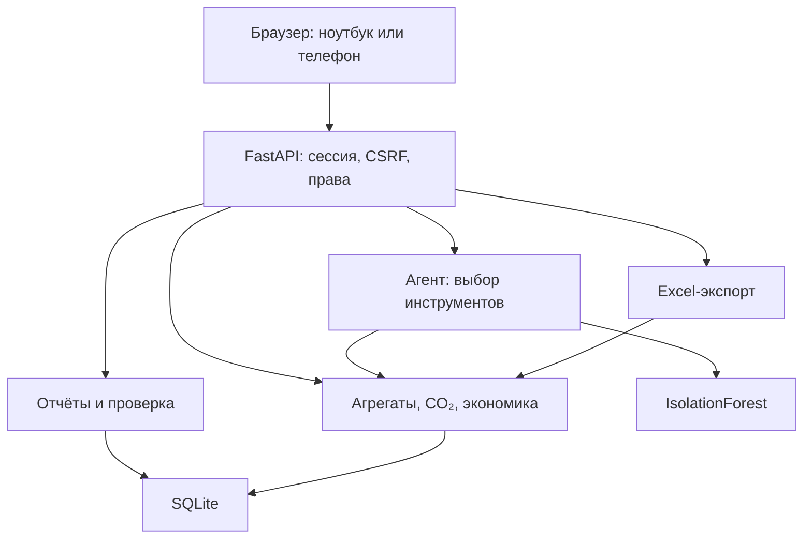
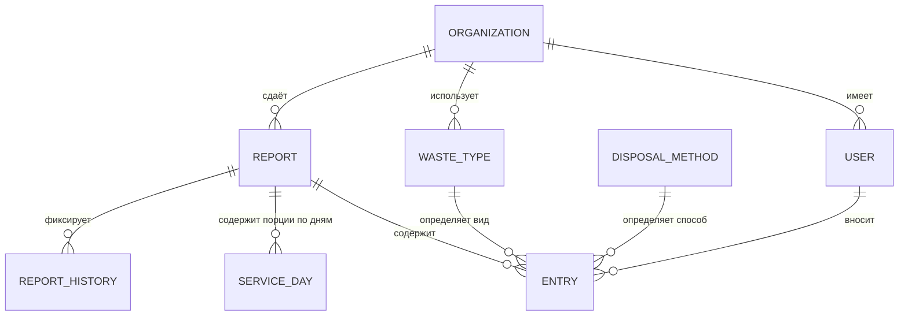
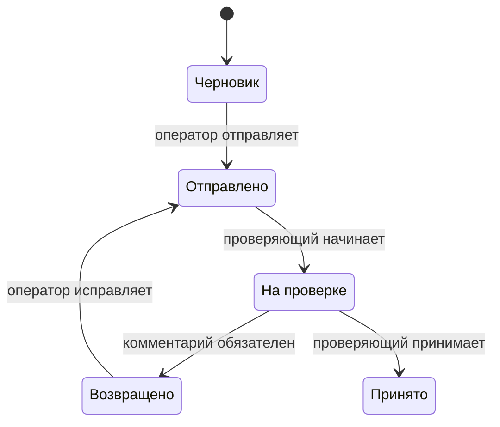

# Архитектура и процесс

## От учёта к общей отчётности

| Этап | Процесс из исходного ТЗ | Процесс в MVP |
| --- | --- | --- |
| Взвешивание | Бумажная или отдельная электронная таблица подразделения | Форма со смартфона, справочники и проверка значений |
| Сдача | Передача отдельных таблиц | Месячный отчёт с явным статусом |
| Проверка | Обсуждение исправлений вне общей записи | Возврат с комментарием, исправление и повторная отправка |
| Сведение | Ручной сбор строк и итогов | Выборка принятых отчётов из общей SQLite |
| Анализ | Отдельный расчёт графиков и показателей | Общие фильтры, три графика, экология и XLSX |

Источник исходного процесса: ТЗ трека, разделы 2–5. Экономия времени требует измерения на площадке.

## Компоненты

Статические HTML/CSS/JavaScript обслуживаются тем же сервером. Один origin устраняет необходимость открывать CORS для произвольных сайтов. База, пароли и настройки не являются статическими файлами.

Frontend предлагает действия по роли и статусу; backend повторно проверяет каждое действие. Он назначает автора записи, проверяет принадлежность подразделению и строит разрешённую выборку для агента. Агент не получает самостоятельного соединения с БД и не расширяет область доступа.

## Логическая модель данных

Организационные справочники расширяются без изменения кода. Использованные элементы деактивируются вместо удаления. Запись сохраняет значимые исторические характеристики вида/метода и расчётные допущения; изменение справочника не должно незаметно переписывать принятую историю.

Физическая схема находится в `app/db.py`. HTTP-схемы и форматы — в `API_CONTRACT.md` и интерактивной документации FastAPI `/docs` при запущенном приложении.

## Состояния отчёта

Редактирование записей разрешено в `draft` и `returned`. После отправки запись блокируется до возврата. `accepted` — окончательное состояние этого MVP.

В DOCX есть неоднозначность: схема описывает возврат в черновик, а перечень статусов и демонстрация требуют видимое «возвращено». Здесь используется отдельный `returned`, разрешающий исправления. История возврата и комментарий остаются видимыми.

Отчёт содержит ревизию. Изменение со старой ревизией отклоняется, чтобы параллельное окно не затёрло новое состояние. Повтор сетевой попытки добавления записи с тем же `client_request_id` не создаёт ещё одно взвешивание. Отдельное одинаковое взвешивание требует явного подтверждения предупреждения о дубле.

## Расчёты

Реестр — представление записей только принятых отчётов. Отдельное ручное копирование в «сводную таблицу» не требуется, поэтому принятие не должно удваивать строки.

Те же фильтры периода, организации, вида и способа используются в реестре, аналитике, экологии и экспорте. Исходные литры и килограммы остаются раздельными; известная масса — отдельная вычисляемая величина. Экология показывает полноту известной массы и количество рассчитанных записей.

Причина и примечание относятся к конкретному взвешиванию. Число порций хранится отдельно один раз на дату отчёта, поэтому несколько строк не дублируют знаменатель. Модуль `app/metrics.py` сопоставляет только разрешённые пары организация/дата со взвешиваниями. Полный показатель кг/100 порций требует положительных порций и известной массы всех выбранных строк каждого дня; частичное покрытие выводится отдельно. День без взвешиваний не объявляется днём с нулевыми отходами. Старые записи мигрируют с причиной `unspecified`, без вымышленных порций. Редактирование порций подчиняется тем же статусам, правам и ревизиям, что взвешивания.

Сценарная экономика отделена от фактического учёта. Высвобождённые часы оцениваются отдельно от денежной экономии, а окупаемость считается только при положительном чистом годовом денежном эффекте.

## Границы эксплуатации

Один процесс FastAPI и SQLite выбраны для локального прототипа. Сервер должен оставаться включённым во время работы браузеров. Для постоянного университетского использования нужны ответственное администрирование, резервные копии, мониторинг, проверка нагрузки и согласованные правила обработки служебных данных.
